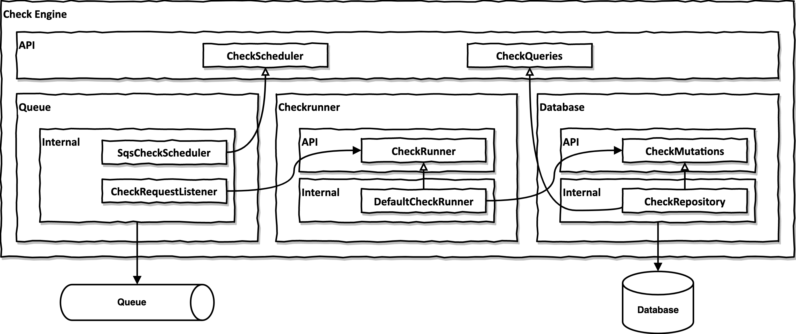

# 컴포넌트 기반 아키텍처 예제

이 저장소는 아래 자료에서 설명하는 Kotlin / Java 기반 컴포넌트 아키텍처의 예제입니다.

- [Clean Architecture Boundaries with Spring Boot and ArchUnit](https://reflectoring.io/java-components-clean-boundaries/) (블로그 글)
- [Let's build components, not layers](https://www.youtube.com/watch?v=-VmhytwBZVs) ([Spring I/O 2019](https://2019.springio.net/) 발표)

## 컴포넌트 아키텍처의 규칙

이 예제 코드베이스에서 사용하는 컴포넌트 기반 아키텍처의 규칙은 다음과 같습니다.

- 컴포넌트는 자신의 네임스페이스를 정의하는 전용 패키지 안의 클래스 집합으로 구성된다.
- 컴포넌트는 전용 `api` 패키지와 `internal` 패키지를 가진다.
- `api` 패키지의 클래스는 외부에서 사용할 수 있다.
- `internal` 패키지의 클래스는 해당 패키지 안의 다른 클래스만 사용할 수 있다(즉, 외부에서는 사용할 수 없다).
- 컴포넌트는 자신의 `internal` 패키지 안에 하위 컴포넌트를 둘 수 있다. 각 하위 컴포넌트는 고유한 자체 패키지에 있어야 한다.

## 예제 컴포넌트

이 코드베이스에는 [check-engine](components/check-engine)이라는 예제 컴포넌트가 들어 있습니다. check-engine은 (단순하긴 하지만) 완전히 동작하는 컴포넌트로, 주어진 웹 페이지에 대해 임의의 체크를 실행하는 역할을 합니다. 체크의 예로는 "`https://foo.bar` 웹 페이지의 HTML이 유효한지 확인"이나 "`https://abc.def` 웹 페이지에 SEO 태그가 제대로 있는지 확인" 같은 것이 있습니다.

이 컴포넌트의 API는 다음 기능을 제공합니다.

- 체크를 비동기 실행하도록 예약한다(`CheckScheduler` 참고).
- 하나 이상의 체크 결과를 조회한다(`CheckQueries` 참고).

check-engine 컴포넌트는 세 개의 하위 컴포넌트로 이루어져 있습니다.

- **queue**: 큐와 연동해 체크를 비동기 실행하도록 예약하는 하위 컴포넌트입니다. 상위 컴포넌트의 `CheckScheduler` API를 구현합니다.
- **database**: 데이터베이스와 연동해 체크 결과를 저장하고 조회하는 하위 컴포넌트입니다. 상위 컴포넌트의 `CheckQueries` API를 구현합니다.
- **checkrunner**: 예약된 체크를 비동기로 실행하고 결과를 데이터베이스에 저장하는 하위 컴포넌트입니다. 상위 컴포넌트의 API는 구현하지 않습니다. checkrunner는 Spring 애플리케이션 컨텍스트에서 `CheckExecutor` 구현체를 찾아, 예약되는 각 체크에 대해 해당 구현체를 실행합니다.

각 컴포넌트(메인 컴포넌트와 하위 컴포넌트)는 동작에 필요한 Spring 빈을 모두 불러오는 자체 Spring `@Configuration` 클래스를 가집니다. 덕분에 통합 테스트를 작성해야 할 때 컴포넌트 트리의 어느 레벨에서든 Spring 컨텍스트를 만들 수 있습니다.

## 컴포넌트 아키텍처 검증하기

위에서 설명한 컴포넌트 기반 접근 방식을 따르면, 다음 규칙 하나로 의존성을 아주 쉽게 검증할 수 있습니다.

> "internal" 패키지 바깥의 어떤 클래스도 그 "internal" 패키지 안의 클래스에 접근해서는 안 된다.

[ArchUnit](https://www.archunit.org/)을 사용하면 코드베이스가 이 규칙을 지키는지 자동으로 테스트할 수 있습니다. [InternalPackageTest](server/src/test/kotlin/io/reflectoring/components/InternalPackageTest.kt)를 참고하세요.

internal 패키지의 이름 규칙을 제대로 지킨다면, _이 테스트 하나로 프로젝트 전체의 컴포넌트 아키텍처를 검증할 수 있습니다_. 새 컴포넌트를 추가하면 자동으로 이 테스트의 검사 대상에 포함됩니다.

잘못된 의존성을 일부러 넣은 뒤 `InternalPackageTest`를 실행해 실패하는 것을 직접 확인해 보세요 :).

## 예제 사용하기

### 요구 사항

- JDK 17 이상
- Docker

### 명령어

모든 명령은 이 프로젝트의 루트 폴더에서 실행합니다.

| 명령어 | 설명 |
| --- | --- |
| `./gradlew build` | 예제 프로젝트를 빌드한다 |
| `./gradlew bootRun` | Spring Boot 앱을 실행한다 (⚠️ datasource가 제대로 설정되지 않아 현재는 동작하지 않음) |
| `./gradlew generateJooq` | Flyway 스크립트로부터 JOOQ 데이터 접근 클래스를 생성한다 |
| `./gradlew composeDownForced` | JOOQ가 사용하는 PostgreSQL Docker 이미지를 제거한다 (Flyway 오류가 날 때 실행) |

## 예제 코드베이스에 대한 논의

이 예제 코드베이스에서 짚어 볼 점은 다음과 같습니다.

- `server` Maven 모듈에는 모든 컴포넌트를 의존성으로 불러오는 Spring Boot 애플리케이션이 들어 있습니다.
- `components` 폴더에는 컴포넌트마다 하나의 Maven 모듈이 있습니다(현재는 최상위 컴포넌트가 하나뿐이지만).
- 이 코드베이스에서 `check-engine` 컴포넌트는 자체 Maven 모듈에 있습니다. 컴포넌트가 고유한 패키지 이름만 가진다면 모든 코드를 하나의 Maven 모듈에 넣는 방식을 택할 수도 있었습니다. 다만 컴포넌트를 자체 Maven 모듈로 분리하면 컴포넌트 경계가 더 뚜렷해집니다.
- 이 코드베이스는 Kotlin을 사용합니다. Java 코드베이스에서도 거의 같은 방식으로 동작합니다.
- 컴포넌트 경계에서 중요한 점은 컴포넌트끼리 데이터베이스를 공유하지 않는다는 것입니다. 데이터베이스를 공유하면 데이터 레이어를 통해 결합되고, 이는 금세 모든 레이어에 걸친 강한 결합으로 이어집니다. 예제 코드에서는 `io.reflectoring.components.checkengine.internal.database` 패키지로 정의된 하위 컴포넌트만이 check-engine의 데이터베이스 테이블에 직접 접근합니다.
- 이 예제는 Flyway로 필요한 데이터베이스 스키마를 생성하고 갱신합니다([common/database](common/database) Maven 모듈 참고). 이 모듈에는 모든 컴포넌트의 데이터베이스 스크립트가 들어 있습니다(이 예제 저장소에는 `check-engine`이라는 컴포넌트 하나뿐이지만). 즉, 모든 컴포넌트가 하나의 데이터베이스 스키마를 공유하되 서로 다른 테이블을 사용하게 됩니다. 컴포넌트 간 데이터를 더 강하게 분리하는 다른 방법(컴포넌트별 스키마, 컴포넌트별 데이터베이스 등)도 있습니다.
- 이 예제는 데이터 접근 레이어에 JOOQ를 사용하며, JOOQ의 소스 생성 기능을 활용합니다.
  - 빌드 중에 [common/database](common/database) 모듈이 PostgreSQL Docker 컨테이너를 띄웁니다.
  - 그다음 Flyway가 [데이터베이스 스크립트](common/database/src/main/resources/db)로 그 PostgreSQL 인스턴스에 데이터베이스 스키마를 생성합니다.
  - 이어서 JOOQ가 스키마를 분석해 스키마의 각 테이블에 대한 데이터 클래스를 생성합니다.
  - 컴포넌트의 데이터 접근 레이어는 이 클래스를 사용해 데이터베이스에 접근합니다. 이렇게 하면 클래스가 항상 데이터베이스 스키마와 동기화된 상태로 유지됩니다.
